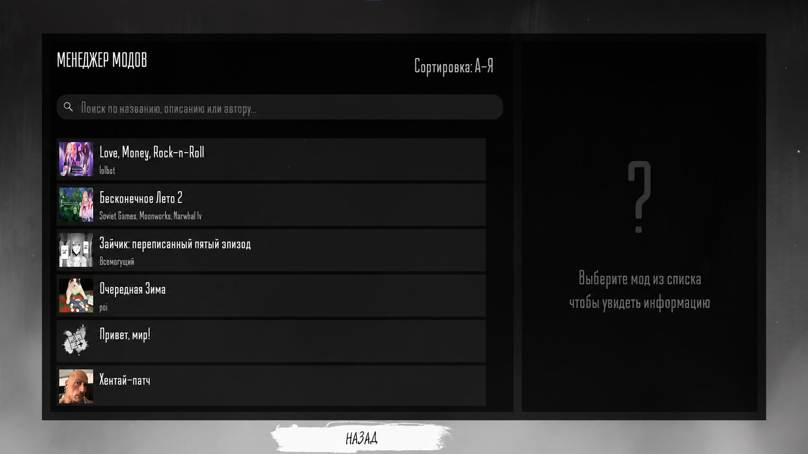

# TBModManager

Менеджер модов для визуальной новеллы "Зайчик".



## Что это делает

TBModManager добавляет кнопку в главное меню, которая открывает браузер модов. Менеджер сканирует папку игры, находит все файлы `mod.ini` и показывает их списком. 

Интерфейс сделан в стиле игры. Поиск работает по названиям, описаниям и авторам. Можно сортировать по алфавиту в обе стороны.

Поддерживает 6 языков: русский, английский, арабский, китайский, итальянский, японский, турецкий.

## Установка

1. Скопируй папку `TBModManager` в директорию игры:

   ```
   D:\GAMES\TinyBunny\game\TBModManager\
   ```

2. Запусти `launcher.exe`, чтобы настроить параметры (необязательно, см. раздел Настройка)

3. Запускай игру как обычно

Лаунчер нужно запустить только один раз, чтобы выставить настройки. Дальше просто запускаешь игру, и менеджер модов будет доступен.

## Как создать мод

Положи файл `mod.ini` в корневую папку своего мода, затем пропиши в нём поля из раздела [Формат mod.ini](#формат-modini)

Пример созданного мода (с .ini файлом, сценарием и аватаркой):

```
game/
└── YourMod/
    ├── mod.ini
    ├── script.rpy
    └── images/
        └── avatar.png
```

### Формат mod.ini

```ini
[your_mod_label]
name = Мой мод
description = Описание мода
avatar = YourMod/images/avatar.png
authors = Автор 1\nАвтор 2\nАвтор 3
```

**Поля:**

- `[section_name]` - Ren'Py label, который запускает мод (должен существовать в твоём .rpy файле)
- `name` - Название мода
- `description` - Текстовое описание мода, есть поддержка `\n` для переносов строк
- `avatar` - Путь к картинке (необязательно, рекомендуется 256x256px)
- `authors` - Имя автора(ов)

### Пример script.rpy

```renpy
label your_mod_label:
    scene bg black
    "Hello world!"

    return
```

Имя label в квадратных скобках `[your_mod_label]` в `mod.ini` должно совпадать с именем вступительного лейбла в твоём моде.
